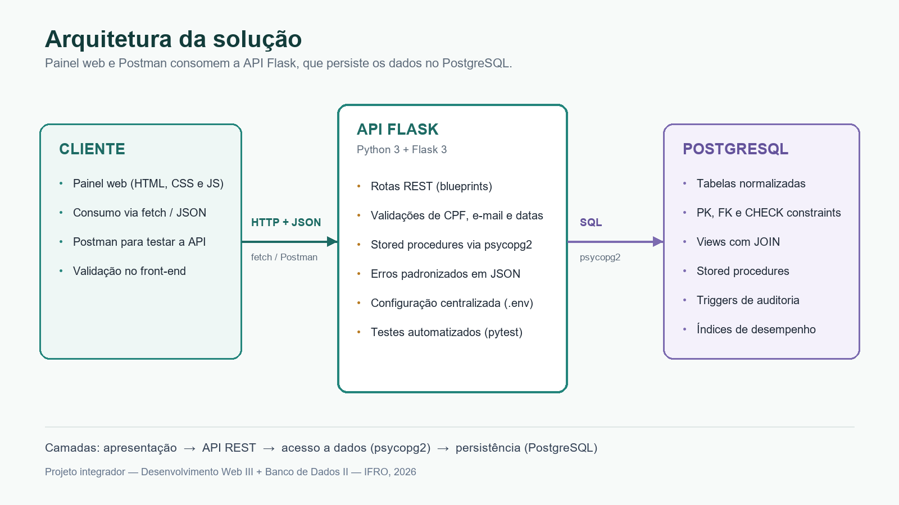
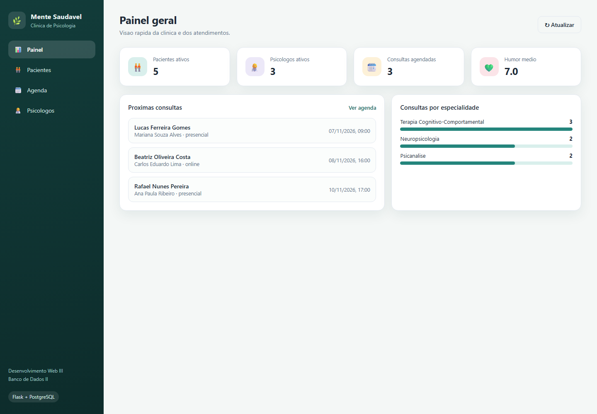
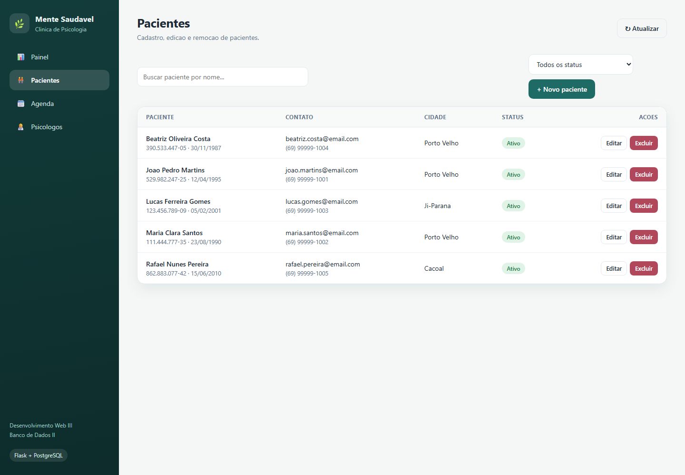
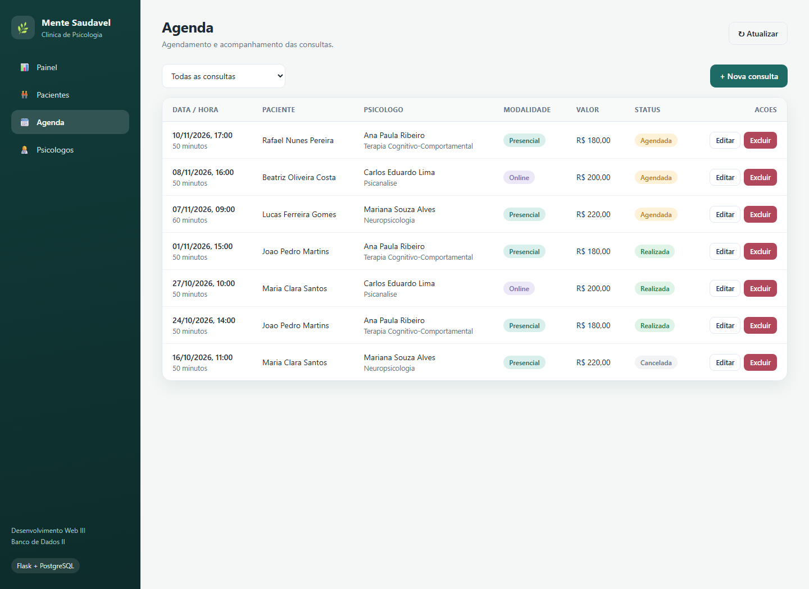
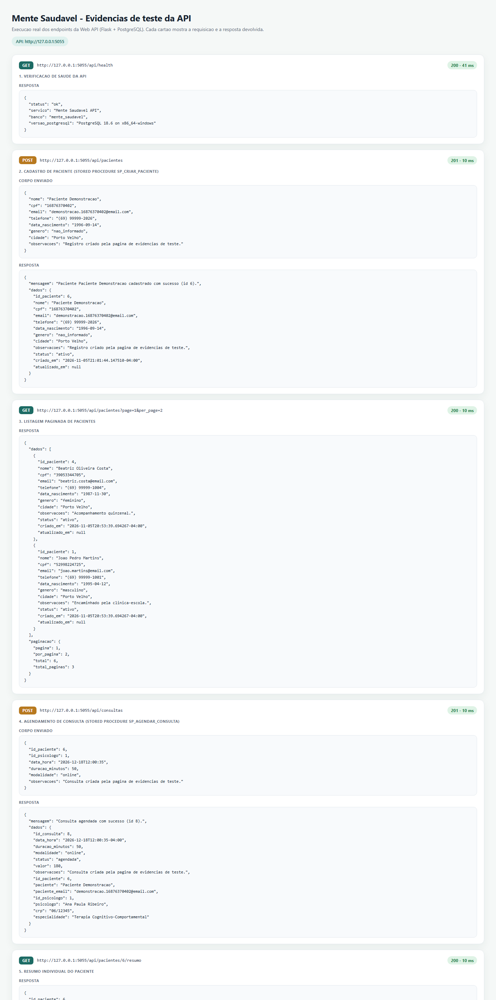
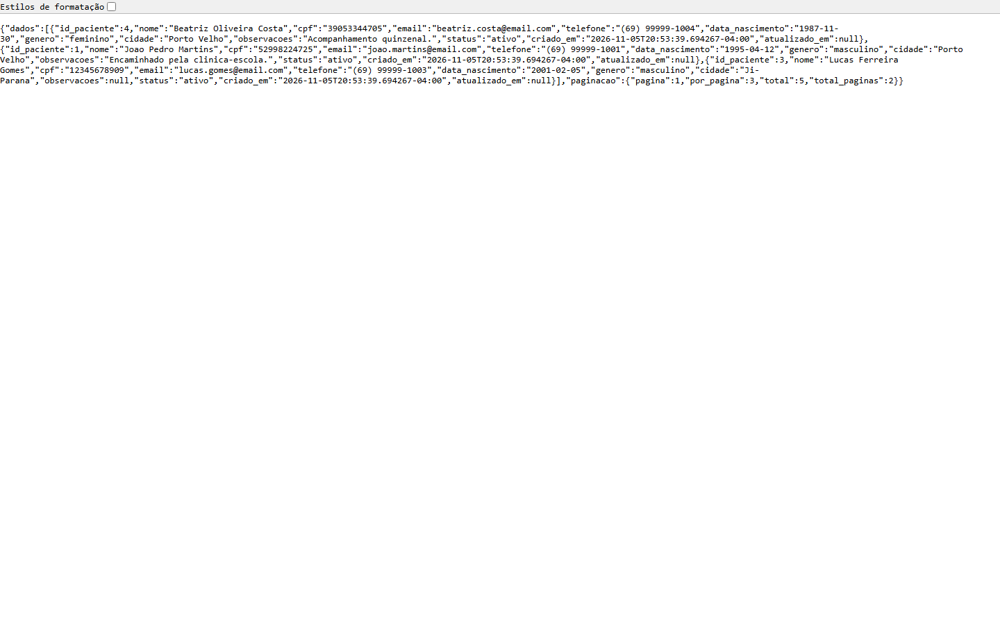

# Mente Saudável — Documentação do Sistema

**INSTITUTO FEDERAL DE EDUCAÇÃO, CIÊNCIA E TECNOLOGIA DE RONDÔNIA**  
Curso Superior de Tecnologia em Sistemas para Internet  
Disciplinas: Desenvolvimento Web III + Banco de Dados II — Turma 2025.1

**Projeto:** Mente Saudável — sistema de gestão para clínica de psicologia  
**Ano:** 2026

**Equipe:** _(preencher com os nomes dos integrantes)_

---

## 1. Introdução

O projeto **Mente Saudável** consiste em uma Web API REST desenvolvida em
Python com o microframework Flask, integrada a um banco de dados PostgreSQL.
O sistema apoia a rotina de uma clínica de psicologia, permitindo gerenciar
pacientes, profissionais, consultas e evoluções clínicas, além de gerar
relatórios de atendimento.

A solução foi construída para atender aos requisitos das disciplinas
Desenvolvimento Web III e Banco de Dados II, aplicando conceitos de
normalização, integridade referencial, *check constraints*, *stored procedures*,
*views* com `JOIN`, *triggers* e troca de mensagens em JSON.

## 2. Objetivo

Desenvolver uma aplicação web com API REST capaz de realizar operações CRUD
sobre os cadastros da clínica, persistindo os dados em um banco relacional bem
estruturado, com validações no front-end, no back-end e no próprio banco de
dados, além de disponibilizar relatórios construídos a partir de *views* e
*stored procedures*.

## 3. Descrição do sistema

O sistema possui quatro módulos principais:

1. **Pacientes** — cadastro, consulta, atualização e remoção de pacientes, com
   validação de CPF (dígitos verificadores), e-mail, data de nascimento e
   status. Cada paciente possui um resumo com total de consultas, consultas
   realizadas, consultas agendadas, humor médio e data da última consulta.
2. **Psicólogos** — cadastro dos profissionais com CRP, especialidade, valor
   padrão da sessão e situação (ativo/inativo).
3. **Consultas** — agendamento com verificação de conflito de horário,
   modalidade (presencial ou online), duração, valor e status (agendada,
   realizada, cancelada ou falta).
4. **Evoluções** — registro do prontuário de cada consulta, contendo nota de
   humor (1 a 10), relato clínico e encaminhamento.

O **painel web** consome a API e apresenta um dashboard com indicadores,
próximas consultas, distribuição por especialidade e tabelas de cadastro.

## 4. Arquitetura da solução



*Figura 1 — Arquitetura da solução: cliente web/Postman, API Flask em camadas e
PostgreSQL.*

A aplicação segue uma organização em camadas:

- **Apresentação:** painel web em HTML, CSS e JavaScript puro, consumindo a API
  com `fetch`; também pode ser testada pelo Postman.
- **API (Flask):** rotas REST organizadas por *blueprints*, validações de
  entrada, tratamento centralizado de erros e serialização JSON.
- **Acesso a dados:** módulo `app/db.py`, responsável pela conexão (psycopg2),
  execução de consultas e chamada de *stored procedures*.
- **Persistência (PostgreSQL):** tabelas normalizadas, chaves primárias e
  estrangeiras, *check constraints*, índices, *triggers*, *views* e
  *stored procedures*.

## 5. Modelo de dados

O banco foi modelado seguindo a normalização (3ª forma normal), evitando
redundância: a evolução referencia apenas a consulta, e os dados do paciente e
do psicólogo são obtidos por `JOIN`.

### 5.1 Tabelas

| Tabela | Chave primária | Chaves estrangeiras | Principais regras |
|--------|----------------|---------------------|-------------------|
| `psicologos` | `id_psicologo` | — | CRP único no formato `UF/número`; e-mail válido; valor da sessão > 0 |
| `pacientes` | `id_paciente` | — | CPF único com 11 dígitos; e-mail válido; nascimento não futuro; status `ativo`/`inativo` |
| `consultas` | `id_consulta` | `id_paciente` → `pacientes`; `id_psicologo` → `psicologos` | Duração entre 15 e 180 min; modalidade e status restritos; valor ≥ 0 |
| `evolucoes` | `id_evolucao` | `id_consulta` → `consultas` (única) | Humor entre 1 e 10; relato com no mínimo 10 caracteres |
| `auditoria_pacientes` | `id_auditoria` | — | Registra INSERT/UPDATE/DELETE com snapshots em JSONB |

### 5.2 Check constraints

Foram implementadas mais de 20 *check constraints*. As principais:

- `ck_pacientes_cpf_formato` — CPF deve conter exatamente 11 dígitos;
- `ck_pacientes_email_formato` — formato mínimo de e-mail;
- `ck_pacientes_nascimento` — data entre 1900 e a data atual;
- `ck_pacientes_status` — apenas `ativo` ou `inativo`;
- `ck_pacientes_genero` — valores predefinidos;
- `ck_psicologos_crp_formato` — CRP no padrão `06/12345`;
- `ck_psicologos_valor_positivo` — valor da sessão maior que zero;
- `ck_consultas_duracao` — entre 15 e 180 minutos;
- `ck_consultas_modalidade` — `presencial` ou `online`;
- `ck_consultas_status` — `agendada`, `realizada`, `cancelada` ou `falta`;
- `ck_evolucoes_humor` — nota de 1 a 10;
- `ck_evolucoes_relato_minimo` — relato com pelo menos 10 caracteres.

Além disso, um **índice único parcial** impede dois agendamentos ativos no
mesmo horário para o mesmo psicólogo, liberando o horário quando a consulta é
cancelada.

### 5.3 Comentários das colunas no script

Conforme exigido, o script `database/01_schema.sql` descreve cada coluna em
comentário. Exemplo:

```sql
CREATE TABLE pacientes (
    id_paciente     SERIAL        PRIMARY KEY,
    nome            VARCHAR(120)  NOT NULL,                          -- Nome completo do paciente
    cpf             CHAR(11)      NOT NULL UNIQUE,                   -- CPF sem pontuacao (11 digitos)
    email           VARCHAR(160)  NOT NULL UNIQUE,                   -- E-mail de contato do paciente
    telefone        VARCHAR(20),                                     -- Telefone com DDD (opcional)
    data_nascimento DATE          NOT NULL,                          -- Data de nascimento do paciente
    genero          VARCHAR(20)   NOT NULL DEFAULT 'nao_informado',  -- Genero declarado pelo paciente
    cidade          VARCHAR(80),                                     -- Cidade onde o paciente reside
    observacoes     TEXT,                                            -- Observacoes gerais do cadastro
    status          VARCHAR(15)   NOT NULL DEFAULT 'ativo',          -- Situacao do cadastro: ativo ou inativo
    criado_em       TIMESTAMPTZ   NOT NULL DEFAULT now(),            -- Data/hora de cadastro
    atualizado_em   TIMESTAMPTZ,                                     -- Data/hora da ultima alteracao
    ...
);
```

## 6. Stored procedures e views

| Objeto | Tipo | Uso |
|--------|------|-----|
| `sp_criar_paciente` | procedure | Chamada em `POST /api/pacientes`; valida CPF/e-mail duplicados e idade mínima |
| `sp_agendar_consulta` | procedure | Chamada em `POST /api/consultas`; valida paciente/psicólogo e conflito de horário |
| `sp_registrar_evolucao` | procedure | Chamada em `POST /api/evolucoes`; garante uma evolução por consulta |
| `sp_relatorio_atendimentos` | procedure | Relatório por período com `REFCURSOR`, lendo a view `vw_relatorio_atendimentos` |
| `vw_agenda_completa` | view | Consultas + pacientes + psicólogos (JOIN de três tabelas) |
| `vw_evolucoes` | view | Prontuário com dados do paciente e do profissional |
| `vw_relatorio_atendimentos` | view | Base do relatório, com `LEFT JOIN` em evoluções |
| `fn_resumo_paciente` | function | Totais de consultas e humor médio por paciente |
| `fn_relatorio_atendimentos` | function | Versão tabular do relatório, consumida pela API |

A procedure de relatório atende ao requisito de usar uma **view com JOIN** e
não é chamada pela API. Exemplo de uso:

```sql
BEGIN;
CALL sp_relatorio_atendimentos(CURRENT_DATE - 30, CURRENT_DATE, 'relatorio');
FETCH ALL FROM relatorio;
COMMIT;
```

## 7. Endpoints da API

| Método | Rota | Descrição |
|--------|------|-----------|
| GET | `/api/health` | Verifica API e conexão com o banco |
| GET | `/api/pacientes` | Lista paginada (filtros `nome`, `status`, `cidade`) |
| GET | `/api/pacientes/{id}` | Busca paciente |
| GET | `/api/pacientes/{id}/resumo` | Resumo individual |
| POST | `/api/pacientes` | Cadastra paciente (procedure) |
| PUT | `/api/pacientes/{id}` | Atualiza paciente |
| DELETE | `/api/pacientes/{id}` | Remove paciente |
| GET/POST | `/api/psicologos` | Lista/cadastra psicólogos |
| GET/PUT/DELETE | `/api/psicologos/{id}` | Consulta/atualiza/remove psicólogo |
| GET | `/api/consultas` | Lista consultas com filtros |
| POST | `/api/consultas` | Agenda consulta (procedure) |
| GET/PUT/DELETE | `/api/consultas/{id}` | Consulta/atualiza/remove consulta |
| GET | `/api/evolucoes` | Lista evoluções |
| POST | `/api/evolucoes` | Registra evolução (procedure) |
| GET/PUT/DELETE | `/api/evolucoes/{id}` | Consulta/atualiza/remove evolução |
| GET | `/api/relatorios/atendimentos` | Relatório por período |
| GET | `/api/relatorios/resumo` | Indicadores gerais |

Todos os dados trafegam em **JSON**. Erros seguem o formato:

```json
{
  "erro": true,
  "mensagem": "CPF invalido: digitos verificadores nao conferem.",
  "status": 422
}
```

## 8. Testes e evidências

Os testes foram executados com o painel web, com uma página de evidências que
dispara requisições reais e com o Postman (coleção incluída em `postman/`).
A suíte automatizada (`pytest`) cobre validações e o fluxo completo da API.

### 8.1 Painel web



*Figura 2 — Painel geral com indicadores, próximas consultas e distribuição por
especialidade.*



*Figura 3 — Tela de pacientes com busca, status e ações de edição/exclusão.*



*Figura 4 — Agenda de consultas com modalidade, valor e status.*

### 8.2 Testes da API



*Figura 5 — Execução real dos endpoints: health check, cadastro de paciente via
stored procedure, listagem, agendamento, resumo individual e relatório.*



*Figura 6 — Resposta JSON da listagem paginada de pacientes.*

### 8.3 Testes automatizados

```text
$ pytest -q
23 passed
```

## 9. Divisão de tarefas

| Integrante | Desenvolvimento | Documentação | Revisão (duplo check) |
|------------|-----------------|--------------|-----------------------|
| _(preencher)_ | Banco de dados, procedures e views | Script SQL comentado | _(outro integrante)_ |
| _(preencher)_ | API Flask e validações | Endpoints e testes | _(outro integrante)_ |
| _(preencher)_ | Frontend e integração | Capturas de tela | _(outro integrante)_ |
| _(preencher)_ | Testes e relatórios | Documento final | _(outro integrante)_ |

## 10. Como executar

1. Criar o banco e executar os scripts na ordem `00`, `01`, `02`, `03`, `04`
   (pasta `database/`).
2. Copiar `.env.example` para `.env` e configurar usuário/senha do PostgreSQL.
3. Criar o ambiente virtual e instalar `requirements.txt`.
4. Executar `python run.py` e acessar `http://localhost:5000`.

Instruções detalhadas estão no `README.md` do repositório.

## 11. Considerações finais

O projeto aplica, de forma integrada, os conteúdos das duas disciplinas: a API
Flask fornece endpoints REST com validações e respostas JSON, enquanto o
PostgreSQL garante a integridade dos dados por meio de chaves, restrições,
procedures, views e triggers. A separação em camadas facilita a manutenção e a
evolução do sistema.
